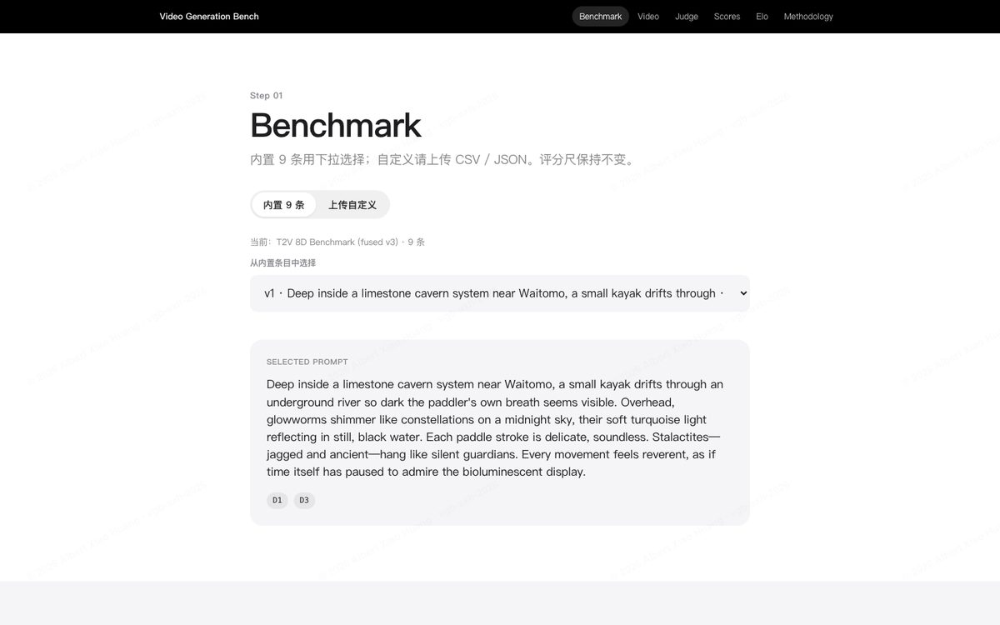
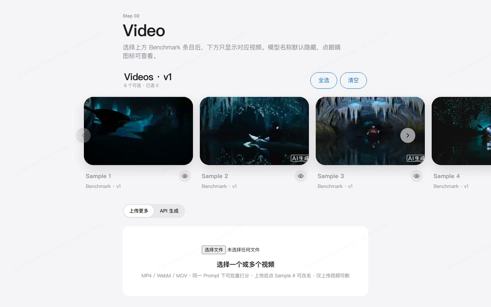
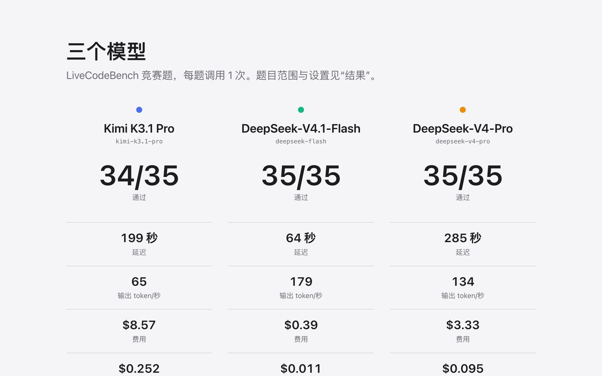
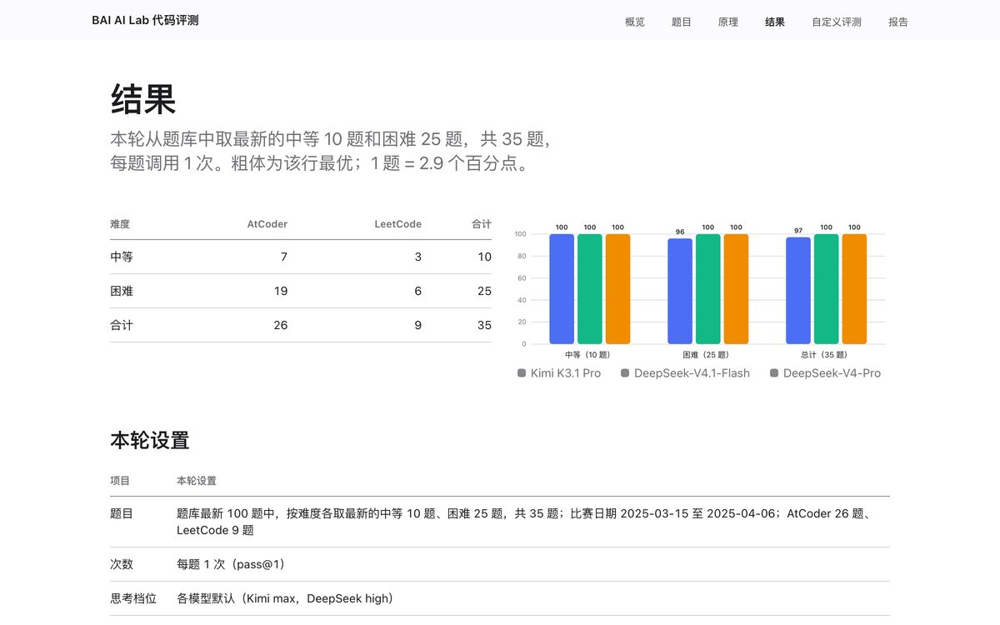
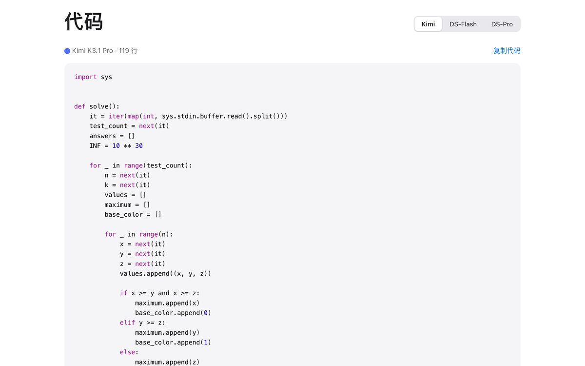
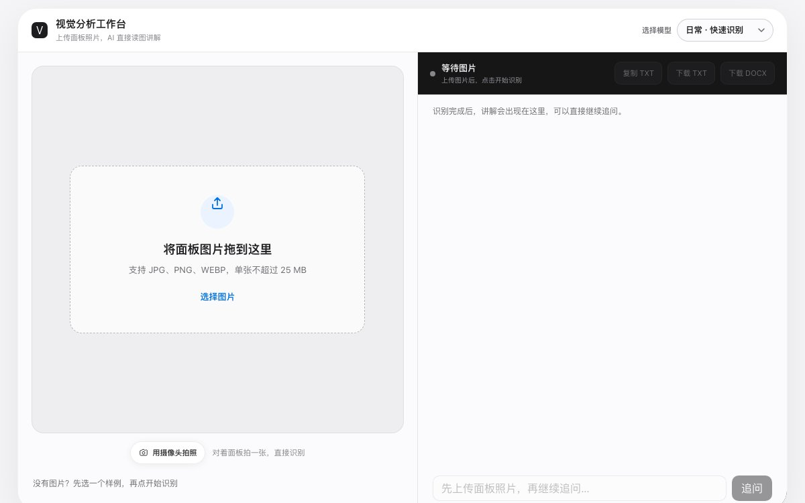
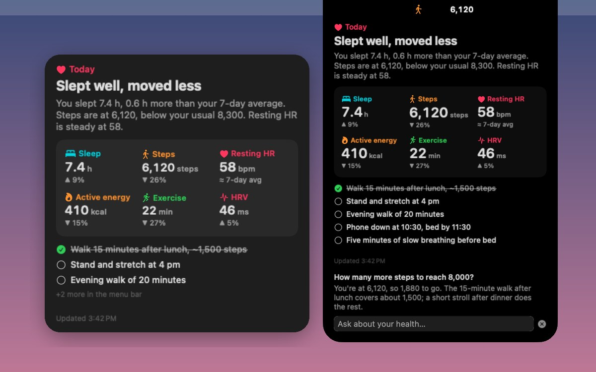
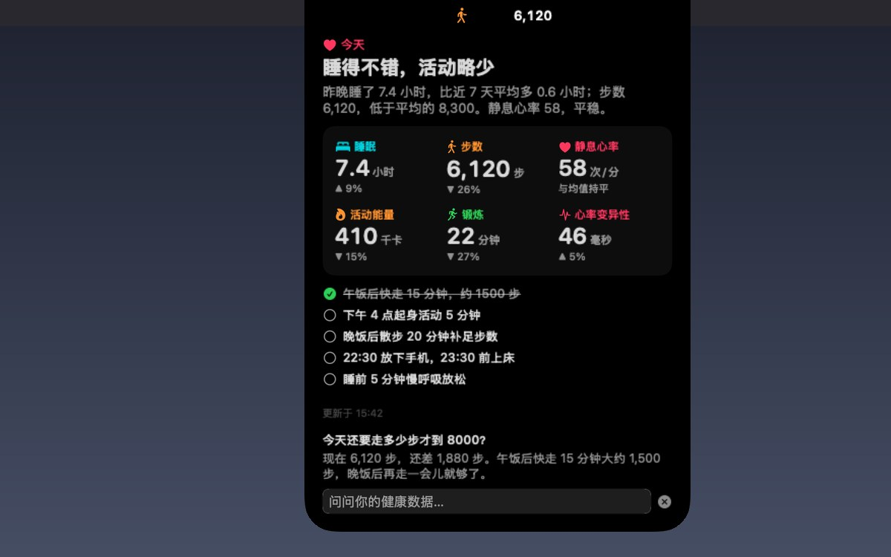
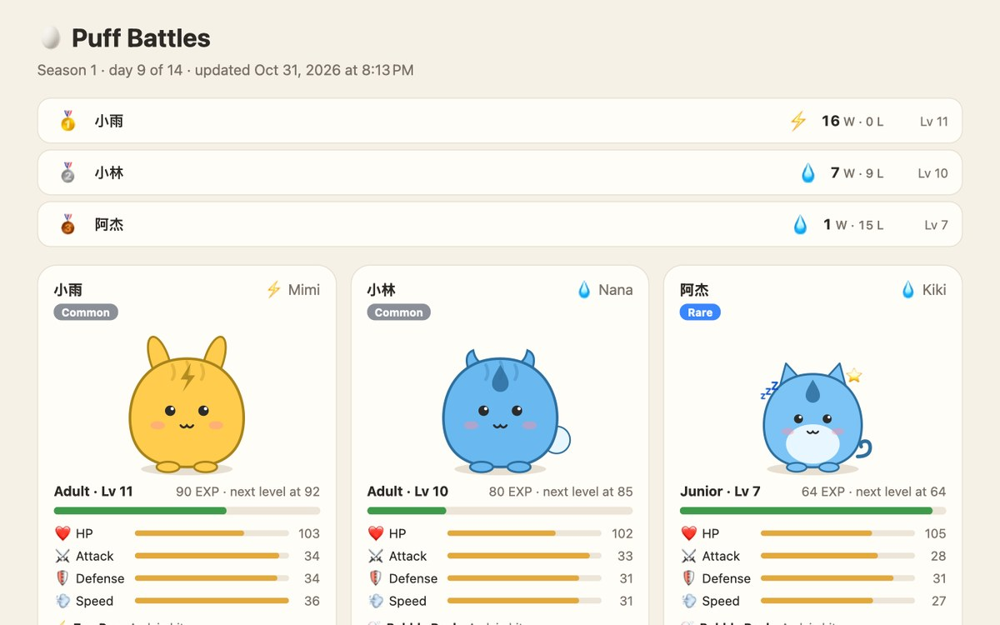

Selected work

<h2 class="pj-title">Built to be tried.</h2>

AI evaluation platforms, a multimodal vision tool and a macOS app. Every window below opens the real thing, so click one and try it.

<b>3</b> live demos<b>1</b> open-source app<b>2</b> AI evaluation platforms

### [Video Generation Bench](https://2dn6bddf.qwenwork.host/)

<i></i>Live demoText-to-video evaluation8-dimension rubricBlind Elo voting

<a href="https://2dn6bddf.qwenwork.host/" target="_blank" rel="noopener">

<i style="background:#ff5f57"></i><i style="background:#febc2e"></i><i style="background:#28c840"></i>2dn6bddf.qwenwork.host · Video Generation Bench

Open live demo ↗

</a>

An evaluation platform I designed and built for text-to-video (T2V) generation models. It pairs an 8-dimension scoring rubric with blind head-to-head Elo voting, so it shows both *where* a model is weak and *which* model people actually prefer.

### [LLM Coding Eval](https://bai-ai-lab.github.io/coding-eval/)

<i></i>Live demoLiveCodeBenchRuntime &amp; costSide-by-side code<a class="pj-doc" href="https://github.com/BAI-AI-Lab/codingBench/blob/main/reports/2026-11-03_ladder_technical_report/main.pdf" target="_blank" rel="noopener"><i class="fas fa-file-pdf" aria-hidden="true"></i>Technical report (PDF) ↗</a>

<a href="https://bai-ai-lab.github.io/coding-eval/" target="_blank" rel="noopener">

<i style="background:#ff5f57"></i><i style="background:#febc2e"></i><i style="background:#28c840"></i>bai-ai-lab.github.io/coding-eval · LLM Coding Eval

Open live demo ↗

</a>

A public results site for the coding evaluation I ran at BAI AI Lab, comparing Kimi K3.1 Pro, DeepSeek-V4.1-Flash and DeepSeek-V4-Pro on the newest LiveCodeBench problems. Beyond pass@1 it reports latency, tokens and cost, measures the runtime, memory and static metrics of every passing answer, shows each model's code side by side, and documents the judging rules and the commands for evaluating your own model. The [technical report](https://github.com/BAI-AI-Lab/codingBench/blob/main/reports/2026-11-03_ladder_technical_report/main.pdf) extends it to a five-tier ladder from USACO to FrontierCS and compares Kimi K3.1 Pro at two reasoning efforts with DeepSeek Flash V4.1-1017 and MiniMax M3.1 Flash.

### [Panel Intelligence](https://hmm5s69m.qwenwork.host/)

<i></i>Live demoMultimodal AICamera or uploadTXT / DOCX export

<a href="https://hmm5s69m.qwenwork.host/" target="_blank" rel="noopener">

<i style="background:#ff5f57"></i><i style="background:#febc2e"></i><i style="background:#28c840"></i>hmm5s69m.qwenwork.host · Panel Intelligence

Open live demo ↗

</a>

A visual analysis workbench for equipment control panels. Upload a photo or take one with your camera, and a multimodal AI model reads the image directly, explaining each switch, indicator light and display, and flagging anything it can't read clearly. You can then ask follow-up questions about the panel and export the explanation as TXT or DOCX.

### [HealthGlance](https://github.com/AlbertHX86/health-glance)

Open sourceSwift &amp; SwiftUIWidgetKitDynamic Island

<a href="https://github.com/AlbertHX86/health-glance" target="_blank" rel="noopener">

<i style="background:#ff5f57"></i><i style="background:#febc2e"></i><i style="background:#28c840"></i>github.com/AlbertHX86/health-glance · HealthGlance

View on GitHub ↗

</a>

A macOS menu-bar app and desktop widget I built that turns iPhone Health data into a daily AI summary. An iPhone shortcut exports the numbers to iCloud Drive; the Mac app has MiniMax write a short summary that compares each number with your own 7-day average, and turns its advice into a checklist you tick off. It shows as a WidgetKit widget, a pinned card or a Dynamic Island that appears when you point at the notch, answers questions about your data, and lets friends who share an iCloud folder compete in a daily pet-battle game. Written in Swift and SwiftUI and built with the Command Line Tools alone.

<h2>More is on the way.</h2>

New evaluations and tools land on GitHub first. Follow along, or read the research behind them.

<a class="pj-btn" href="https://github.com/AlbertHX86" target="_blank" rel="noopener">Follow on GitHub ↗</a><a class="pj-btn pj-btn--ghost" href="/publications/">Read my publications</a>

